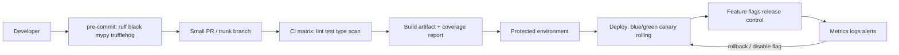

# Production Delivery Engineering

> Topic package — Week 01+ · Roadmap Week 01+ — Production Delivery Engineering.
> Depth goal: design production delivery systems that make every change traceable, testable, releasable, observable, and reversible: CI/CD pipelines, pre-commit gates, branch strategy, versioning, security scanning, feature flags, contracts, and rollout patterns.

## Source
- Track: Software Engineering (self-directed, FDE roadmap)
- Slide deck: `07 Resources Library/Software Engineering/Slides/Lesson_05_Production_Delivery_Engineering.pptx`
- Hands-on notebook: `07 Resources Library/Software Engineering/Notebooks/05_Production_Delivery_Engineering.ipynb` (runs offline)
- Reference reading: Accelerate (Forsgren/Humble/Kim); Continuous Delivery (Humble/Farley); GitHub Actions documentation; pre-commit, ruff, black, mypy, pytest-cov, mutmut, Bandit, pip-audit docs; OpenFeature and LaunchDarkly architecture notes; Pact documentation; Release Please documentation
- Builds on: [[02 Literature Notes/Software Engineering/Software Engineering Refresh]]
- Date: 2026-07-18

---

## 1. Mental Model

**Production delivery engineering is a risk-reduction system, not a YAML hobby.** The pipeline should answer four questions on every change: is the code understandable, is the behavior proven, is the artifact reproducible, and can the rollout be stopped or reversed without heroic manual work?

Mature teams separate **deploy** from **release**. They build once, scan once, attach provenance, promote the same artifact through environments, and expose functionality with feature flags or progressive rollout. Git workflow, pre-commit hooks, CI checks, semantic versions, changelogs, coverage gates, SAST/SCA, contract tests, and deployment strategies are all controls in one socio-technical system.

> Key intuition: **optimize for small, boring, reversible changes** — the best delivery system makes the safe path the fastest path.



---

## 2. How It Actually Works

### 1+.1 CI/CD pipelines are executable policy
A useful GitHub Actions pipeline runs the same categories of checks developers run locally, but with production constraints: pinned action versions, `permissions: contents: read`, Python matrix builds such as 3.11 and 3.12, dependency caching keyed on the lockfile, uploaded coverage and build artifacts, and protected `environment` gates for staging/production. Required branch checks should include format/lint, type check, unit/integration tests, security scan, and artifact build.

Real tradeoff: every check has a feedback-loop cost. Put sub-10-second formatting and obvious secret checks in pre-commit; keep PR CI under roughly 10 minutes for normal services; move slow mutation or full e2e suites to nightly or pre-release unless they protect critical revenue paths.

### 1+.2 Pre-commit, coverage, mutation, and security gates
A production Python repo commonly uses pre-commit hooks for `ruff`, `black`, `mypy`, and `trufflehog` secret scanning before code leaves the laptop. CI then repeats critical checks in a clean environment and adds `pytest --cov --cov-fail-under=80`, `bandit -r src`, `pip-audit`, and dependency automation with Dependabot or Renovate.

Coverage is a guardrail, not a goal: 85% line coverage with no assertions can still miss the failure. Mutation testing with `mutmut` measures whether tests detect changed behavior, but it is CPU-expensive; teams often run it on core domain modules nightly or before high-risk releases rather than on every PR.

### 1+.3 Branching, PR size, versioning, and changelogs
Trunk-based development wins when teams can keep branches short-lived, behind flags, and continuously integrated. A practical rule is PRs under about 300-500 changed lines, merged within 24-48 hours, with one behavioral concern per PR. GitFlow can still win for packaged products, regulated release trains, or long-lived supported versions where release branches carry backports.

Semantic versioning and Conventional Commits turn history into release automation: `feat:` increments minor, `fix:` increments patch, `BREAKING CHANGE:` increments major. Release Please-style automation opens a release PR containing the changelog and version bump, so humans review release notes instead of hand-editing them at 5 p.m.

### 1+.4 Decouple deploy from release with flags and contracts
Feature flags let teams deploy dormant code and release to 1%, 10%, one tenant, or internal users after the artifact is already live. LaunchDarkly-style systems need stable flag keys, typed variations, percentage rollout based on deterministic user hashing, kill switches, audit logs, and cleanup deadlines; stale flags become a hidden distributed configuration system.

Contract testing complements flags when multiple teams ship independently. Pact-style consumer-driven contracts pin what each consumer actually relies on, catching provider changes before deployment. Use contracts for service boundaries and public APIs; do not confuse them with full end-to-end tests of every path.

### 1+.5 Repo topology and deployment strategies
Monorepos centralize atomic refactors, shared tooling, and visibility but require build graph discipline and ownership boundaries; polyrepos give autonomy and smaller blast radius but make cross-service changes, dependency upgrades, and governance harder. Enterprise teams often choose monorepo for tightly-coupled product surfaces and polyrepo for independently governed platforms.

Deployment strategy should match risk. Rolling deploys are simple for stateless services. Blue/green gives fast rollback at 2x capacity cost. Canary deploys expose 1-5% first and require metrics good enough to auto-abort. Feature-flag rollouts control behavior while the deploy mechanism controls bits; both need dashboards and rollback owners.

---

## 3. Implementation

Assumed stack: Python stdlib only. Snippets model real delivery controls offline: a GitHub Actions workflow string with structural validation, and deterministic feature-flag rollout hashing. Snippets:
- [[04 Code Snippets/Software Engineering/SE Week 01+ GitHub Actions Delivery Workflow Validator]]
- [[04 Code Snippets/Software Engineering/SE Week 01+ Deterministic Feature Flag Rollout Evaluator]]

### SE Week 01+ GitHub Actions Delivery Workflow Validator
Embed a realistic GitHub Actions workflow as a Python string and validate required production controls without network access.
```python
import re

GITHUB_ACTIONS_WORKFLOW = '''
name: ci
on:
  pull_request:
  push:
    branches: [main]
permissions:
  contents: read
jobs:
  test:
    runs-on: ubuntu-latest
    strategy:
      matrix:
        python-version: ['3.11', '3.12']
    steps:
      - uses: actions/checkout@v4
      - uses: actions/setup-python@v5
        with:
          python-version: ${{ matrix.python-version }}
          cache: pip
      - run: python -m pip install -r requirements.txt -r requirements-dev.txt
      - run: ruff check . && black --check . && mypy src
      - run: pytest --cov=src --cov-fail-under=85 --junitxml=reports/junit.xml
      - run: bandit -r src && pip-audit
      - uses: actions/upload-artifact@v4
        with:
          name: test-reports-${{ matrix.python-version }}
          path: reports/
  deploy-staging:
    needs: test
    runs-on: ubuntu-latest
    environment: staging
    steps:
      - run: echo deploy immutable artifact to staging
'''

REQUIRED_PATTERNS = {
    "least_privilege_permissions": r"permissions:\s*\n\s*contents: read",
    "matrix_python": r"matrix:\s*\n\s*python-version:.*3\.11.*3\.12",
    "dependency_cache": r"cache: pip",
    "coverage_gate": r"--cov-fail-under=85",
    "sast_sca": r"bandit -r src && pip-audit",
    "artifact_upload": r"actions/upload-artifact@v4",
    "protected_environment": r"environment: staging",
}

def validate_workflow(text):
    missing = [name for name, pattern in REQUIRED_PATTERNS.items()
               if not re.search(pattern, text, flags=re.S)]
    return {"ok": not missing, "missing": missing, "lines": len(text.splitlines())}

print(validate_workflow(GITHUB_ACTIONS_WORKFLOW))
```

### SE Week 01+ Deterministic Feature Flag Rollout Evaluator
A LaunchDarkly-style percentage rollout evaluator using stable SHA-256 buckets, tenant targeting, and kill-switch behavior.
```python
from dataclasses import dataclass, field
import hashlib

@dataclass(frozen=True)
class FeatureFlag:
    key: str
    enabled: bool
    rollout_percent: int = 0
    allow_tenants: set[str] = field(default_factory=set)
    deny_users: set[str] = field(default_factory=set)

def bucket(flag_key, user_id, salt="prod"):
    digest = hashlib.sha256(f"{salt}:{flag_key}:{user_id}".encode()).hexdigest()
    return int(digest[:8], 16) % 100

def evaluate(flag, user_id, tenant_id):
    if not flag.enabled or user_id in flag.deny_users:
        return False
    if tenant_id in flag.allow_tenants:
        return True
    return bucket(flag.key, user_id) < flag.rollout_percent

flag = FeatureFlag("llm_answer_v2", enabled=True, rollout_percent=25, allow_tenants={"acme"})
for user, tenant in [("u1", "acme"), ("u2", "beta"), ("u3", "beta"), ("u4", "beta")]:
    print(user, tenant, bucket(flag.key, user), evaluate(flag, user, tenant))
```

---

## 4. Design Decisions & Tradeoffs

| Decision | Guidance |
|---|---|
| **Trunk-based vs GitFlow** | Use trunk-based for SaaS/AI services with flags, short branches, and continuous deploy; use GitFlow or release branches for packaged clients, regulated release trains, and maintained older versions. |
| **Required checks** | Make GitHub branch protection require ruff/black, mypy, pytest with pytest-cov, Bandit, pip-audit, and artifact build; keep mutmut nightly unless the changed package is safety-critical. |
| **Version automation** | Use Conventional Commits plus Release Please for libraries and APIs; for internal apps still tag deployable artifacts with commit SHA and changelog links. |
| **Dependency automation** | Use Dependabot for GitHub-native simplicity or Renovate for monorepo grouping, schedules, and custom managers; require CI green before auto-merge. |
| **Monorepo vs polyrepo** | Choose monorepo with Bazel/Nx/Turborepo-style affected builds for shared platform work; choose polyrepo when service ownership, compliance, and independent lifecycle dominate. |
| **Rollout mechanism** | Use blue/green when rollback speed matters and 2x capacity is acceptable; use canary with SLO metrics for high-traffic services; use flags for tenant/user release control. |

---

## 5. Failure Modes & Gotchas

- CI installs floating dependencies and deploys from the working tree → non-reproducible artifact during rollback.
- Required checks omit secret scanning → a token reaches GitHub history and must be rotated under incident pressure.
- Coverage gate rises to 90% but mutation score stays near zero → tests execute lines without verifying behavior.
- Long-lived branches merge after two weeks → integration conflict, duplicated migrations, and a Friday release freeze.
- Feature flag is left permanent with no owner or expiry → every future change must reason about dead production branches.
- Canary has no business/SLO guardrail → bad release reaches 100% because only container health was monitored.

---

## 6. FDE Angle

- Enterprise AI deployments need repeatable delivery because client security teams will ask exactly what code, model config, prompt version, and dependency set is running.
- Feature flags let an FDE deploy an LLM workflow once, then enable it for one pilot tenant, internal reviewers, or 5% of users without redeploying.
- SAST/SCA and secret scanning catch the boring risks around AI apps: leaked API keys, vulnerable parsers, unsafe deserialization, and stale transitive dependencies.
- Contract tests protect integrations with client systems and LLM tool APIs when retries, schema changes, or provider migrations happen under deadline.

---

## 7. Self-Check

1. Which checks belong in pre-commit, PR CI, nightly CI, and protected deployment environments?
2. Why does build-once/promote-many reduce rollback and audit risk?
3. When does GitFlow beat trunk-based development despite slower integration?
4. What makes a coverage gate misleading, and how does mutation testing change the signal?
5. How do feature flags decouple deploy from release, and what operational debt do they create?
6. Which deployment strategy would you choose for a stateful service versus a stateless API?

---

## 9. Interview Q&A

**Q: Why does the note insist on separating "deploy" from "release" as two genuinely different events, rather than treating a deployment as automatically meaning the feature is live?**
A: If "deploy" and "release" are the same event, then shipping new code and exposing new behavior to users happen at exactly the same moment — which means the only way to control who sees new behavior, and when, is to control the deploy itself (deploying to a subset of servers, timing deploys around low-traffic windows, etc.). That's a clumsy, high-stakes lever: the artifact going live and the behavior going live are coupled, so if something's wrong with the new behavior, the only way to undo it is to redeploy the old artifact — which is slower and riskier than just flipping a switch.

Separating them means the artifact can be deployed — fully built, fully live in production, running on real infrastructure — while the new behavior stays dormant behind a feature flag, invisible to users until someone explicitly decides to release it (to 1% of traffic, to one pilot tenant, to internal reviewers first). This turns "something's wrong with the new behavior" from a redeploy-and-rollback problem into a flip-a-flag-off problem, which is dramatically faster and lower-risk — the artifact doesn't even need to change, just the flag's state. It also means release timing becomes a product/business decision (when do we want this tenant to see this feature) completely decoupled from deploy timing (when is the code safely built and running) — two different concerns that used to be forced to happen at the same moment now have independent, appropriately-owned decision points.

*One-liner: coupling deploy and release means the only lever for controlling who sees new behavior is the deploy itself, so undoing a bad behavior requires a redeploy — separating them lets the artifact go live fully dormant behind a flag, turning "something's wrong" into a fast flag-flip instead of a slower rollback, and letting release timing (a product decision) be decoupled entirely from deploy timing (an engineering/safety decision).*

**Q: The note says "coverage is a guardrail, not a goal" and that 85% coverage with no real assertions can still miss failures — what's actually happening when a test suite has high coverage but a near-zero mutation score?**
A: Code coverage measures whether a line of code was *executed* during the test run — it says nothing about whether the test actually checked that the code produced the *correct* result when it ran. A test that calls a function and never asserts anything about its return value (or asserts something trivially true, like `assert result is not None` on a function that never returns None anyway) will still count that function's lines as "covered," because the line genuinely did execute — but the test provides zero actual protection against that function's logic being subtly wrong, since nothing about its specific behavior was ever actually checked.

Mutation testing directly measures the thing coverage can't: it takes your actual source code, deliberately introduces small, specific bugs (a mutation — flipping a `>` to `>=`, changing `+` to `-`, inverting a boolean), and then re-runs your existing test suite against that mutated code. If your tests still pass despite the code now containing a real, deliberately-introduced bug, that's a "surviving mutant" — concrete proof that your tests weren't actually checking the specific behavior that mutation altered, even though coverage numbers looked fine the whole time (the mutated line was still "covered," it just wasn't meaningfully verified). High coverage with a low mutation score is the specific, measurable signature of exactly this gap: lots of code gets executed during tests, but comparatively little of that execution is backed by an assertion that would actually catch a real behavioral change.

*One-liner: coverage measures whether a line executed during testing, not whether the test actually verified the line produced the correct result — mutation testing exposes this gap directly by deliberately introducing small bugs and checking whether your existing tests catch them; high coverage with a low mutation score means lots of code is being executed by tests that aren't meaningfully asserting on its behavior, so a "surviving mutant" proves a real bug could ship right through tests that still show green.*

**Q: When would GitFlow (or release branches) actually beat trunk-based development, despite trunk-based generally being the preferred default here?**
A: Trunk-based development's core advantage — fast integration, short-lived branches, continuous deployment of a single evolving mainline — assumes you're shipping one continuously-evolving product to users who are always on (or soon will be on) the latest version, which is the normal situation for a SaaS product or an internally-deployed AI service. GitFlow's release-branch model earns its cost specifically when that assumption breaks: when you have multiple, simultaneously-supported versions of the software in the field at once, not just "the current version" — packaged software customers running different installed versions, a regulated industry requiring a formal, auditable release train with its own approval gates, or long-term-support versions that still need security patches backported to them long after the mainline has moved on.

In that situation, release branches give you a genuine, necessary capability trunk-based development doesn't have on its own: the ability to patch an older, still-supported release (backport a critical fix to v2.3 for customers who haven't upgraded to v3.0 yet) without that fix being entangled with whatever unrelated, in-progress work has since landed on the mainline branch. Trunk-based development, by design, doesn't really have a clean notion of "the v2.3 branch" separate from "wherever main currently is" — which is exactly the capability a GitFlow-style release-branch strategy is built to provide, at the cost of more complex branch management and typically slower integration of new work into the stable mainline.

*One-liner: trunk-based development assumes one continuously-evolving mainline that users are always moving toward — GitFlow's release branches earn their cost specifically when you have multiple, simultaneously-supported versions in the field at once (packaged software, regulated release trains, long-term-support backports), since that's the genuine capability release branches provide (patching an old, still-supported version in isolation) that a single evolving trunk doesn't cleanly support on its own.*

**Q: How do feature flags actually decouple deploy from release, and what's the concrete operational debt the note warns they create if left unmanaged?**
A: Mechanically, a feature flag is a runtime check — "is this flag on for this user/tenant" — wrapped around a code path, evaluated at request time rather than at deploy time. This is what makes the decoupling real: the new code can be fully deployed and running in production (the "deploy" event already happened) while the flag stays off for everyone, meaning the new behavior is genuinely dormant and invisible (the "release" event hasn't happened yet) until someone flips the flag for some percentage, tenant, or user cohort — at which point release happens instantly, with no new deploy required, because the code was already there the whole time, just gated off.

The operational debt the note warns about is specifically what happens when a flag is left in place indefinitely with no clear owner and no planned removal date: every future engineer reading that code now has to reason about two different code paths (flag-on and flag-off) indefinitely, even long after the decision ("should this feature be fully on") has effectively already been made and never revisited. At scale, with many such permanent flags accumulated over time, this becomes exactly what the note calls "a hidden distributed configuration system" — a sprawling, implicit set of runtime toggles that nobody has a full mental model of anymore, each one adding a small but real tax to every future change that happens to touch code near it (does this change need to work correctly under both flag states? is anyone even sure what state this flag is actually in across different environments right now?). The fix is treating a flag's eventual removal (once a rollout is complete and the decision is final) as part of the flag's actual lifecycle, not an optional cleanup task that competes with other work and usually loses.

*One-liner: a feature flag is a runtime check gating a code path, which is what lets the code be deployed fully dormant and only actually released later by flipping the flag with no new deploy — the operational debt comes from flags left permanently in place with no owner or removal plan, which forces every future reader to reason about two code paths indefinitely for a decision that was effectively already made, accumulating into what the note calls "a hidden distributed configuration system" at scale.*

**Q: What's the actual tradeoff between blue/green and canary deployment strategies — when does each one genuinely win?**
A: Blue/green deploys a complete second, fully-scaled copy of the environment (the "green" version) alongside the currently-live one ("blue"), then switches all traffic over at once, typically via a load-balancer or DNS change. Its genuine strength is rollback speed: if something's wrong with green, switching all traffic back to blue is nearly instantaneous, since blue never stopped running and is still fully warmed up and ready — there's no need to wait for a gradual traffic shift to reverse, you just flip the switch back. The real cost is capacity: running two complete, fully-scaled environments simultaneously (even briefly, during the cutover window) means paying for roughly 2x the infrastructure during that window, which matters more for expensive or stateful infrastructure than for cheap, easily-scaled stateless compute.

Canary deployment instead routes a small percentage of traffic (1-5%, in the note's framing) to the new version first, while the rest continues hitting the old version, and gradually increases that percentage as confidence grows — rather than an instant, complete cutover. Its genuine strength is blast-radius control: if the new version has a real problem, only that small percentage of traffic/users actually experienced it, not everyone at once, which matters enormously for high-traffic services where "100% of users briefly hit a broken version" is a much bigger incident than "5% did." But canary's real requirement — and the note's explicit warning — is that it only actually protects you if you have metrics and SLO guardrails good enough to automatically detect a problem in that small canary slice and abort the rollout before it progresses further; a canary deploy with only container-health monitoring (is the process still running) can let a functionally-broken release reach 100% of traffic, since "the process didn't crash" says nothing about whether it's actually producing correct results.

*One-liner: blue/green wins when rollback speed matters most and you can afford roughly 2x capacity during cutover, since switching back to a still-warm, fully-scaled old environment is nearly instant — canary wins for high-traffic services where limiting blast radius matters most, but it only actually protects you if you have real behavioral/business metrics (not just container health) good enough to auto-detect a problem in the small canary slice and abort before it reaches everyone.*

## 8. Links
- Domain MOC: [[06 Maps of Content/Software Engineering Concepts]]
- Code: [[04 Code Snippets/Software Engineering/SE Week 01+ GitHub Actions Delivery Workflow Validator]], [[04 Code Snippets/Software Engineering/SE Week 01+ Deterministic Feature Flag Rollout Evaluator]]
- Distilled: [[03 Permanent Notes/SE Week 01+ CI CD Pipeline Design Checklist]], [[03 Permanent Notes/SE Week 01+ Deployment Strategies Decision Guide]]
- Upstream: [[02 Literature Notes/Software Engineering/Software Engineering Refresh]] · Downstream: [[02 Literature Notes/Software Engineering/System Design Fundamentals]]
