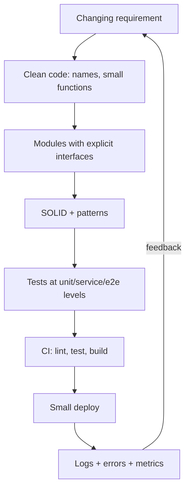

# Software Engineering Refresh

> Topic package — Week 01 · Roadmap Week 01 — Software Engineering Refresh.
> Depth goal: refresh the engineering fundamentals that make AI/FDE systems maintainable: small interfaces, clear boundaries, reliable error paths, observable behavior, intentional tests, and disciplined delivery.

## Source
- Track: Software Engineering (self-directed, FDE roadmap)
- Slide deck: `07 Resources Library/Software Engineering/Slides/Lesson_01_Software_Engineering_Refresh.pptx`
- Hands-on notebook: `07 Resources Library/Software Engineering/Notebooks/01_Software_Engineering_Refresh.ipynb` (runs offline)
- Reference reading: Clean Code (Martin); Design Patterns (Gamma et al.); Refactoring (Fowler); Accelerate (Forsgren/Humble/Kim); Google SRE Workbook; pytest and GitHub Actions documentation
- Date: 2026-07-18

---

## 1. Mental Model

**Software engineering is the discipline of making change safe.** Clean code reduces local cognitive load; SOLID and patterns reduce coupling; modular architecture contains blast radius; tests, logs, git, and CI/CD create fast feedback loops so teams can ship confidently.

For an AI Forward Deployed Engineer, fundamentals matter because demos become production faster than expected. A prototype that mixes domain logic, vendor calls, configuration, and logging will be impossible to debug at a client site. A small set of boring practices — dependency inversion, structured errors, contract tests, and trunk-based delivery — keeps the system adaptable when requirements move.

> Key intuition: **optimize for reversible, observable change** — code should reveal intent, isolate policy from mechanics, fail loudly with context, and prove its behavior automatically.



---

## 2. How It Actually Works

### 1.1 Clean code is about preserving intent
Clean code is not aesthetic minimalism; it is code whose **reason for existing** survives the next edit. Prefer domain names over implementation names, short functions with one level of abstraction, explicit return values over hidden mutation, and early exits over deeply nested control flow. Comments should explain non-obvious *why*, not restate the *what*.

The senior tradeoff is knowing when abstraction pays rent. Duplication across two call sites is often cheaper than a premature framework; duplication across policy decisions is dangerous because it lets business rules diverge. Refactor toward concepts the domain already has: `InvoicePolicy`, `RetryBudget`, `DocumentChunker`, not `ManagerHelperUtil`.

### 1.2 SOLID as change-containment rules
SOLID is useful when treated as a set of pressure gauges rather than dogma. **Single Responsibility** asks: what kind of change should force this module to change? **Open/Closed** says new variants should be added by extension when variants are frequent. **Liskov** protects substitutability: tests for a port should pass for every adapter. **Interface Segregation** prevents clients from depending on methods they do not use. **Dependency Inversion** keeps domain policy independent from infrastructure.

In FDE work, DIP is the highest leverage: put client/vendor/database details behind ports so a demo using in-memory data can become a production integration without rewriting the core workflow.

### 1.3 Patterns and modular architecture
Design patterns are names for recurring tradeoffs. Strategy handles interchangeable policies; Adapter wraps external APIs; Factory centralizes construction; Facade simplifies a subsystem; Observer/Event Bus decouples producers from consumers. Use a pattern when it makes a future change path explicit, not because patterns are fashionable.

Modular architecture means each module owns a coherent slice: domain model, application/service orchestration, infrastructure adapters, and presentation/API. Dependencies should point inward toward stable policy. If a domain object imports HTTP clients, cloud SDKs, or UI code, the boundary has leaked and tests will become slow, brittle, and hard to reason about.

### 1.4 Error handling, logging, and observability
Good systems distinguish expected domain failures from programmer bugs and infrastructure faults. Return typed results or raise domain-specific exceptions at boundaries; preserve original exceptions with chaining; add context once at the boundary where you know request/user/job identifiers. Avoid broad `except Exception: pass`, boolean success flags with no reason, and logs that cannot be joined across a request.

Structured logging is the minimum viable observability layer. Emit stable event names plus fields (`request_id`, `customer_id`, `operation`, `duration_ms`, `error_type`) instead of prose-only strings. A future incident response should answer: what failed, for whom, how often, and after which dependency call?

### 1.5 Testing, git workflow, and CI/CD
A practical test strategy is a portfolio. Unit tests pin pure rules and edge cases; integration tests verify adapters and persistence; contract tests protect module/API boundaries; a small number of end-to-end tests cover critical journeys. The testing pyramid is really a feedback-speed pyramid: most tests should be fast enough to run locally on every change.

Use small branches or trunk-based development, meaningful commits, pull requests that isolate one concern, and CI that runs the same commands developers run locally. CD basics are equally boring: build once, promote artifacts, keep configuration outside code, migrate safely, deploy small, and roll back quickly. The goal is not process ceremony; it is reducing the cost of being wrong.

---

## 3. Implementation

Assumed stack: Python stdlib only. Snippets show SOLID/pattern boundaries and production-grade error/logging shape without external services. Snippets:
- [[04 Code Snippets/Software Engineering/SE Week 01 SOLID Strategy Boundary Example]]
- [[04 Code Snippets/Software Engineering/SE Week 01 Structured Logging and Error Boundary]]

### SE Week 01 SOLID Strategy Boundary Example
A small Strategy + Dependency Inversion example: domain pricing depends on a policy interface, not vendor/infrastructure code.
```python
from dataclasses import dataclass
from typing import Protocol

@dataclass(frozen=True)
class Order:
    customer_tier: str
    subtotal_cents: int

class DiscountPolicy(Protocol):
    def discount_cents(self, order: Order) -> int: ...

class TierDiscount:
    def __init__(self, rates):
        self.rates = rates
    def discount_cents(self, order):
        return int(order.subtotal_cents * self.rates.get(order.customer_tier, 0.0))

class NoDiscount:
    def discount_cents(self, order):
        return 0

class Pricer:
    def __init__(self, policy: DiscountPolicy):
        self.policy = policy          # depends on abstraction, not concrete vendor logic
    def total_cents(self, order):
        discount = self.policy.discount_cents(order)
        if discount < 0 or discount > order.subtotal_cents:
            raise ValueError("invalid discount policy result")
        return order.subtotal_cents - discount

order = Order(customer_tier="gold", subtotal_cents=10_000)
print(Pricer(TierDiscount({"gold": 0.15})).total_cents(order))
print(Pricer(NoDiscount()).total_cents(order))
```

### SE Week 01 Structured Logging and Error Boundary
Wrap an application boundary with typed errors, exception chaining, and structured JSON logs.
```python
import json, logging, sys

class PaymentDeclined(Exception):
    pass

class GatewayUnavailable(Exception):
    pass

logger = logging.getLogger("checkout")
logger.setLevel(logging.INFO)
handler = logging.StreamHandler(sys.stdout)
handler.setFormatter(logging.Formatter("%(message)s"))
logger.handlers[:] = [handler]

def log_event(event, **fields):
    logger.info(json.dumps({"event": event, **fields}, sort_keys=True))

def charge_gateway(amount_cents):
    if amount_cents <= 0:
        raise PaymentDeclined("amount must be positive")
    if amount_cents == 503:
        raise TimeoutError("gateway timed out")
    return {"auth_code": "OK123"}

def checkout(request_id, amount_cents):
    try:
        result = charge_gateway(amount_cents)
        log_event("checkout.succeeded", request_id=request_id, amount_cents=amount_cents)
        return result
    except PaymentDeclined:
        log_event("checkout.declined", request_id=request_id, amount_cents=amount_cents)
        raise
    except TimeoutError as exc:
        log_event("checkout.gateway_unavailable", request_id=request_id, error_type=type(exc).__name__)
        raise GatewayUnavailable("payment gateway unavailable") from exc

print(checkout("req-1", 2500))
try:
    checkout("req-2", 503)
except GatewayUnavailable as exc:
    print(type(exc).__name__, "caused by", type(exc.__cause__).__name__)
```

---

## 4. Design Decisions & Tradeoffs

| Decision | Guidance |
|---|---|
| **Abstraction timing** | Abstract around stable domain seams or frequent variation; do not build generic frameworks before the second or third concrete use case proves the shape. |
| **Dependency direction** | Keep domain/application policy independent from UI, storage, network, and vendor SDKs; adapters depend inward, not the reverse. |
| **Pattern selection** | Use Strategy for interchangeable policies, Adapter for external systems, Factory for construction, and Facade for subsystem simplification; avoid pattern stacking that hides simple control flow. |
| **Error surface** | Expose domain errors to callers, wrap infrastructure failures at boundaries, and preserve causes with exception chaining for debugging. |
| **Test mix** | Bias toward fast unit and contract tests; add integration tests for adapters and only a few high-value end-to-end flows. |
| **Delivery workflow** | Prefer small PRs, trunk-friendly branches, CI on every change, build-once artifacts, feature flags, and rollback plans over big-bang releases. |

---

## 5. Failure Modes & Gotchas

- Treating SOLID as ceremony → many tiny interfaces with no actual change pressure.
- Letting domain logic import HTTP clients, databases, or vendor SDKs → slow tests and expensive rewrites.
- Catching broad exceptions and returning `None` → lost root cause and silent data corruption.
- Logging prose without stable fields → incidents cannot be grouped by customer, request, or dependency.
- An inverted test pyramid with mostly brittle UI/e2e tests → slow feedback and ignored red builds.
- Long-lived branches and manual deploy steps → integration surprises, unreproducible releases, and rollback panic.

---

## 6. FDE Angle

- Client deployments move through unknowns quickly; clean boundaries let you swap a mock, CSV, SaaS API, or on-prem connector without rewriting core policy.
- A client-facing AI workflow needs auditability: structured logs, typed errors, and testable contracts are how you explain behavior under pressure.
- The FDE deliverable is rarely just code; it is a maintainable slice with tests, CI, runbook-quality logs, and a safe path to iterate with users.
- When an LLM integration fails, software fundamentals decide whether you can isolate prompt, data, vendor, orchestration, or deployment causes in minutes instead of days.

---

## 7. Self-Check

1. What kind of change should force a module to change, and how does that relate to Single Responsibility?
2. Where should dependencies point in a layered or hexagonal codebase?
3. When would Strategy be better than a long `if/elif` chain?
4. How do you preserve root cause while exposing a clean application error?
5. What belongs in unit, integration, contract, and end-to-end tests?
6. What should CI prove before a change is merged or deployed?

---

## 9. Interview Q&A

**Q: Why is Dependency Inversion called out as "the highest leverage" SOLID principle for FDE work specifically, rather than, say, Single Responsibility?**
A: FDE work has a specific recurring shape: you build something against one concrete environment (a demo's in-memory data, a sandbox API, a single client's auth scheme), and then that same workflow has to survive being pointed at a completely different concrete environment (production data, a different client's API, a different auth provider) without a rewrite. Dependency Inversion is the principle that directly targets this exact pain: if the domain policy (the actual business logic — pricing, eligibility, routing) depends only on an abstract port/interface, and the concrete vendor/database/API detail is just one swappable adapter behind that port, then swapping environments means writing a new adapter, not touching the workflow that already works and is already tested.

Single Responsibility and the other SOLID principles matter too, but they're mostly about *internal* change containment — keeping one module from having too many reasons to change. DIP is specifically about the *boundary* between your logic and the outside world, which is exactly the boundary that moves every time an FDE goes from a demo to a pilot to a production client integration. Get DIP right and a demo-to-production transition is "write a new adapter, run the same tests." Get it wrong (business logic directly importing an HTTP client or a cloud SDK) and the same transition means re-deriving the business logic inside whatever integration code happens to be nearby.

*One-liner: Single Responsibility and the other SOLID principles mostly contain change inside a module, but Dependency Inversion specifically protects the exact boundary — business logic vs. concrete vendor/infrastructure detail — that moves every time an FDE engagement goes from demo to pilot to production, which is why it's the one with outsized leverage for this specific kind of work.*

**Q: The note says duplication across two call sites is often cheaper than a premature framework, but duplication across policy decisions is dangerous. What's the actual distinction being drawn here?**
A: The distinction is about *what kind* of thing is being duplicated, not whether duplication exists at all. Two call sites that happen to both format a date the same way, or both validate that a string isn't empty, are duplicating a small, stable, low-stakes mechanical detail — extracting that into a shared abstraction before you've seen a third or fourth use case risks guessing the wrong shape for that abstraction, and guessing wrong is its own tax (now you have an abstraction that almost-but-not-quite fits every call site, with special-case parameters creeping in to paper over the mismatch).

Duplicating a *policy* — a business rule like "gold-tier customers get a 15% discount" or "a payment under $50 doesn't need manager approval" — is dangerous for a completely different reason: if that rule is written out independently in two places, there is nothing stopping the two copies from silently drifting apart over time as one gets updated and the other doesn't. That's not a code-cleanliness problem, it's a correctness problem — the system now has two different answers to "what's the actual rule," and which one applies depends on which code path happened to run. The fix isn't "always abstract" or "never duplicate" — it's recognizing that business rules need exactly one source of truth, while small mechanical repetition can wait until a real pattern has actually emerged.

*One-liner: duplicating a small mechanical detail (date formatting, a null check) is low-stakes and worth waiting on, since extracting it too early risks guessing the wrong abstraction shape — duplicating an actual business rule is dangerous because the two copies can silently drift apart, giving the system two different, conflicting answers to "what's the rule," which is a correctness bug, not a cleanliness one.*

**Q: What specifically goes wrong when domain logic imports an HTTP client or a cloud SDK directly, beyond "it's not clean"?**
A: Two concrete, practical failures follow directly from this, not just an aesthetic complaint. First, testing becomes slow and flaky: a unit test for a pricing rule now has to either actually make a network call (slow, flaky, requires live credentials, fails in CI for reasons unrelated to the pricing logic itself) or awkwardly mock deep internals of an HTTP client library just to test a rule that has nothing to do with HTTP — the test suite for your core business logic now inherits all the failure modes of a network client.

Second, and more costly long-term: when the concrete integration needs to change (a different vendor, a new auth scheme, moving from a REST API to an event stream), that change is now tangled directly into the business logic that happens to sit next to it, rather than being isolated to one small adapter. You can't swap the vendor without touching — and re-testing, and re-reasoning-about — the actual pricing/eligibility/routing rules, even though those rules themselves didn't change at all. This is the concrete, practical cost behind "the boundary has leaked": it's not a style violation, it's business logic and infrastructure detail now being forced to change together even when only one of them actually needs to.

*One-liner: domain logic directly importing infrastructure code doesn't just look messy — it makes tests slow and flaky (business-rule tests now inherit network-client failure modes) and it entangles infrastructure changes with business-logic changes, forcing you to touch and re-test rules that didn't actually change just because the vendor behind them did.*

**Q: When would Strategy actually be better than a long if/elif chain, and when would it just be unnecessary ceremony?**
A: Strategy earns its cost specifically when the set of "variants" (pricing tiers, discount policies, routing rules) is expected to grow or change independently of the code that uses them, and when each variant is substantial enough to deserve its own tested unit. In that situation, an if/elif chain means every new variant requires editing a function that already handles every other variant too — growing, increasingly tangled, and risking a change to one branch accidentally affecting another through shared local state or sloppy copy-paste. Strategy isolates each variant into its own small, independently testable unit, and adding a new one means adding a new class, not editing existing ones (this is the Open/Closed principle in practice).

It becomes unnecessary ceremony when the "variants" are genuinely few, genuinely stable, and each branch is trivially simple (a one-line return based on a flag) — in that case, a short if/elif is more readable at a glance than jumping across several small classes to understand the same logic, and Strategy adds indirection (an interface, implementing classes, a factory to pick one) without a corresponding benefit, since there's no real variation pressure to protect against. The deciding question isn't "is there branching logic" — it's "will new branches keep showing up, and is each branch substantial enough that isolating it actually helps."

*One-liner: Strategy earns its cost when variants are expected to grow independently and each one is substantial enough to deserve isolated testing — it's ceremony when the variants are few, stable, and trivially simple, where a short if/elif is more readable than the added indirection of classes and a factory with no real variation pressure to justify it.*

**Q: How do you preserve the real root cause of a failure while still exposing a clean, typed error to the caller?**
A: The mechanism is exception chaining — catching the low-level, infrastructure-specific error (a timeout, a connection reset) and re-raising a higher-level, domain-meaningful error (like `GatewayUnavailable`) using `raise NewError(...) from original_exception`, rather than either letting the raw infrastructure exception escape unchanged, or catching and re-raising a generic error with no reference back to what actually happened underneath.

This matters because the caller of your application-level code shouldn't need to know or care about `TimeoutError` vs. `ConnectionResetError` vs. whatever vendor-specific exception class a particular HTTP library happens to throw — they need a clean, stable, domain-meaningful signal like "the payment gateway is unavailable" that they can actually write calling code against, regardless of which specific library or protocol is underneath. But when something actually goes wrong in production and you're debugging it, you absolutely do need the original, specific, low-level cause — "the gateway was unavailable" alone doesn't tell you if it was a DNS failure, a timeout, or a 500 response, and that distinction matters for figuring out what to actually fix. Exception chaining gives you both: a clean, stable error type for callers to handle, and the full original cause preserved and inspectable (via `exc.__cause__` in Python) for whoever needs to debug the real underlying failure later.

*One-liner: catch the low-level infrastructure exception and re-raise a clean, domain-meaningful error using exception chaining (`raise DomainError(...) from original_exc`) rather than either leaking the raw infrastructure exception to callers or discarding it entirely — this gives callers a stable, meaningful error type to handle while still preserving the real underlying cause for whoever has to debug the failure later.*

**Q: What's the actual difference in purpose between unit, integration, contract, and end-to-end tests — not just "where they run," but what each one is actually there to catch?**
A: Each level is designed to catch a different class of mistake, which is why a good suite needs all of them rather than just picking the one that feels most thorough. Unit tests pin down pure logic and edge cases in isolation — given these exact inputs, does this one function/class produce the exact right output, including the weird edge cases (empty input, boundary values, negative numbers) that are cheap to enumerate when nothing else needs to be running. They're fast specifically because they test one thing with no real dependencies, which is what lets you run hundreds of them on every save.

Integration tests check that your code and a *real* dependency (an actual database, an actual queue, an actual adapter implementation) actually work together correctly — a unit test might mock the database entirely and still pass even if the real SQL query has a typo, so integration tests exist specifically to catch the class of bug that only shows up when two real pieces actually touch. Contract tests protect a boundary between modules or services from drifting apart independently — they check that "what module A promises to provide" and "what module B expects to receive" still actually match, which matters specifically when two pieces are built or deployed somewhat independently and could silently diverge without either side's own tests catching it (each side's own tests only check against its own assumptions about the other side). End-to-end tests cover a small number of genuinely critical user journeys through the real, assembled system, to catch the class of bug that only appears when everything is wired together for real — but they're deliberately kept few, because they're slow and more brittle than the other three levels.

*One-liner: unit tests catch wrong logic in isolation (fast, cheap, many of them); integration tests catch two real pieces not actually working together even though each is individually correct; contract tests catch two independently-built/deployed modules silently drifting apart in what they promise vs. expect from each other; end-to-end tests catch problems that only emerge when the whole real system is wired together, which is exactly why there should only be a few of them.*

## 8. Links
- Domain MOC: [[06 Maps of Content/Software Engineering Concepts]]
- Code: [[04 Code Snippets/Software Engineering/SE Week 01 SOLID Strategy Boundary Example]], [[04 Code Snippets/Software Engineering/SE Week 01 Structured Logging and Error Boundary]]
- Distilled: [[03 Permanent Notes/SE Week 01 SOLID Principles Quick Reference]], [[03 Permanent Notes/SE Week 01 Testing Pyramid and Delivery Strategy]]
- Upstream: [[06 Maps of Content/Software Engineering Concepts]] · Downstream: [[02 Literature Notes/Software Engineering/System Design Fundamentals]]
