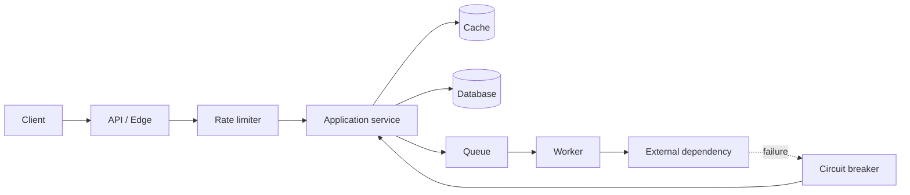

# System Design Fundamentals

> Topic package — Week 02 · Roadmap Week 02 — System Design Fundamentals.
> Depth goal: reason about system design fundamentals with practical tradeoffs: request flow, boundaries, service decomposition, eventing, queues, caching, rate limiting, scalability, reliability, and fault tolerance.

## Source
- Track: Software Engineering (self-directed, FDE roadmap)
- Slide deck: `07 Resources Library/Software Engineering/Slides/Lesson_02_System_Design_Fundamentals.pptx`
- Hands-on notebook: `07 Resources Library/Software Engineering/Notebooks/02_System_Design_Fundamentals.ipynb` (runs offline)
- Reference reading: Designing Data-Intensive Applications (Kleppmann); Release It! (Nygard); Google SRE Book; Enterprise Integration Patterns; AWS Well-Architected Reliability Pillar; Martin Fowler articles on microservices and hexagonal architecture
- Builds on: [[02 Literature Notes/Software Engineering/Software Engineering Refresh]]
- Date: 2026-07-18

---

## 1. Mental Model

**System design is controlled tradeoff management under load and failure.** A useful design names the boundary of each component, the data it owns, the synchronous and asynchronous paths between components, and the behavior when dependencies slow down, fail, or return partial results.

Client-server and layered architectures teach request/response separation; hexagonal architecture protects business policy from transport and persistence; microservices trade independent deployability for distributed-systems complexity; event-driven designs and queues decouple time and load; caching and rate limits buy performance and protection at the cost of consistency and fairness decisions.

> Key intuition: **architecture is where you choose your failure modes** — every cache, queue, service boundary, and retry policy moves latency, consistency, and operational burden somewhere.



---

## 2. How It Actually Works

### 2.1 Client-server, layers, and request flow
Client-server splits consumers from providers: clients express intent over a protocol, servers enforce policy and own data. Layered architecture then separates presentation/API, application orchestration, domain rules, and infrastructure. The benefit is understandable flow and testable seams; the risk is an anemic stack where every change requires plumbing through layers with no real boundary.

Senior design starts with request shape: who calls whom, what is synchronous, what is idempotent, what data is read/written, and what timeout applies. A sequence diagram is often more valuable than a box diagram because it reveals latency accumulation and hidden coupling.

### 2.2 Hexagonal architecture and service boundaries
Hexagonal (ports and adapters) architecture puts domain/application policy at the center and treats HTTP, databases, queues, and vendor APIs as replaceable adapters. Input ports represent use cases; output ports represent capabilities needed by the core. This is especially useful when an FDE prototype starts with local files or mocks and later connects to client systems.

Microservices apply a stronger boundary: each service should own data and deploy independently around a business capability. The trade is real: teams gain autonomy and scaling isolation, but pay with network latency, versioning, observability, retries, distributed transactions, and on-call complexity. If one team owns everything and the database is shared, a modular monolith is often the better first design.

### 2.3 Event-driven architecture, queues, and backpressure
Event-driven systems publish facts that happened (`OrderPaid`, `DocumentIndexed`) so consumers can react without blocking the producer. Queues decouple time: producers enqueue quickly, workers process at their pace, and bursts are smoothed. They also create new responsibilities: idempotent handlers, dead-letter queues, ordering guarantees, retry policy, and visibility into lag.

Events are not remote procedure calls with worse debugging. Use commands when you need a specific service to do something; use events when multiple consumers may independently react to a fact. Design for at-least-once delivery unless the infrastructure proves otherwise; exactly-once claims usually hide idempotency work somewhere else.

### 2.4 Caching, rate limiting, and scalability
Scalability is not only adding machines; it is reducing expensive work and controlling demand. Caches lower latency and backend load, but require key design, TTLs, invalidation, warmup, stampede protection, and correctness rules. Read-through, write-through, write-behind, and cache-aside each move complexity differently.

Rate limiting protects shared resources and creates fair allocation. Token bucket allows bursts while enforcing a long-term rate; leaky bucket smooths traffic; fixed windows are simple but bursty at boundaries. Limits should be observable and product-aware: per user, tenant, API key, route, or downstream dependency, with clear retry-after behavior.

### 2.5 Reliability and fault tolerance
Reliability is the probability the system performs correctly over time; fault tolerance is the ability to keep operating despite component failures. Techniques include timeouts, retries with jitter, circuit breakers, bulkheads, idempotency keys, replication, health checks, graceful degradation, and disaster recovery.

Retries are dangerous without budgets: they can amplify an outage. Timeouts must be shorter than caller deadlines. Circuit breakers prevent repeated calls to a dependency already known to be failing. Graceful degradation should be a product decision: serve cached data, partial answers, queued work, or a clear failure message depending on user value and risk.

---

## 3. Implementation

Assumed stack: Python stdlib only. Snippets simulate rate limiting and caching locally so notebooks execute offline. Snippets:
- [[04 Code Snippets/Software Engineering/SE Week 02 Token Bucket Rate Limiter]]
- [[04 Code Snippets/Software Engineering/SE Week 02 In-Memory LRU Cache]]

### SE Week 02 Token Bucket Rate Limiter
A deterministic token-bucket limiter with simulated timestamps: burst capacity plus sustained refill rate.
```python
from dataclasses import dataclass

@dataclass
class TokenBucket:
    capacity: float
    refill_per_second: float
    tokens: float = 0.0
    updated_at: float = 0.0

    def __post_init__(self):
        self.tokens = self.capacity

    def allow(self, now, cost=1.0):
        elapsed = max(0.0, now - self.updated_at)
        self.tokens = min(self.capacity, self.tokens + elapsed * self.refill_per_second)
        self.updated_at = now
        if self.tokens >= cost:
            self.tokens -= cost
            return True
        return False

bucket = TokenBucket(capacity=3, refill_per_second=1)
for t in [0, 0, 0, 0, 1.0, 1.1, 2.0]:
    print(f"t={t:>3}: allow={bucket.allow(t)} tokens={bucket.tokens:.1f}")
```

### SE Week 02 In-Memory LRU Cache
A tiny LRU cache showing eviction, hit/miss accounting, and cache-aside usage.
```python
from collections import OrderedDict

class LRUCache:
    def __init__(self, capacity):
        self.capacity = capacity
        self.data = OrderedDict()
        self.hits = 0
        self.misses = 0

    def get(self, key, loader):
        if key in self.data:
            self.hits += 1
            self.data.move_to_end(key)
            return self.data[key]
        self.misses += 1
        value = loader(key)
        self.data[key] = value
        self.data.move_to_end(key)
        if len(self.data) > self.capacity:
            self.data.popitem(last=False)
        return value

cache = LRUCache(capacity=2)
load = lambda key: f"value-for-{key}"
for key in ["a", "b", "a", "c", "b"]:
    print(key, "->", cache.get(key, load), "keys=", list(cache.data))
print("hits", cache.hits, "misses", cache.misses)
```

---

## 4. Design Decisions & Tradeoffs

| Decision | Guidance |
|---|---|
| **Monolith vs microservices** | Start with a modular monolith unless independent deployment, scaling, ownership, or compliance boundaries justify distributed complexity. |
| **Synchronous vs asynchronous** | Use sync calls when the user needs an immediate answer; use queues/events for slow work, bursts, fanout, and resilience to dependency downtime. |
| **Events vs commands** | Publish events for facts multiple consumers may react to; send commands when one target must perform a requested action. |
| **Cache placement** | Cache close to the expensive read path, but define ownership, TTL, invalidation, stampede behavior, and acceptable staleness before relying on it. |
| **Rate limit dimension** | Limit by the scarce resource and fairness goal: user, tenant, API key, route, job type, or downstream dependency. |
| **Failure policy** | Set deadlines, retry budgets, circuit breakers, idempotency keys, and degradation behavior explicitly; defaults create accidental outages. |

---

## 5. Failure Modes & Gotchas

- Drawing boxes without request sequences → hidden synchronous chains and impossible latency budgets.
- Splitting into microservices while sharing one database and one team → distributed monolith with worse deploys.
- Using events as RPC → producers wait mentally on consumers and debugging becomes harder than direct calls.
- Adding retries without timeouts, jitter, or budgets → retry storm that amplifies an outage.
- Caching mutable data with no invalidation rule → fast stale answers and client trust erosion.
- Rate limiting globally instead of per tenant or dependency → noisy neighbors still starve critical users.

---

## 6. FDE Angle

- FDE system design often starts with a client workflow, not a greenfield platform; sequence the happy path and the failure path before choosing infrastructure.
- A credible architecture review states tradeoffs: why sync vs async, why cache here, why this limit dimension, and what the user sees on degradation.
- For AI systems, queues and caches are practical tools for expensive model calls, document indexing, embedding refresh, and vendor API protection.
- The deliverable is a runnable slice plus an operations story: dashboards/log fields, backpressure behavior, replay/idempotency, and rollback/degradation choices.

---

## 7. Self-Check

1. What does a sequence diagram reveal that a component diagram can hide?
2. When is a modular monolith preferable to microservices?
3. What makes a queue consumer safe under at-least-once delivery?
4. Which cache invalidation strategy fits mutable user-specific data?
5. How does token bucket differ from fixed-window limiting?
6. How do timeouts, retries, and circuit breakers interact?

---

## 9. Interview Q&A

**Q: Why would you choose a modular monolith over microservices even when you know the system will eventually need to scale?**
A: The case for microservices rests on a specific set of benefits — independent deployability, independent scaling, team autonomy, isolated failure domains — and every one of those benefits only actually materializes when the organizational and operational reality matches the architecture. If one team owns the whole system and there's one shared database underneath, splitting into microservices doesn't actually deliver independent deployability (changes still have to be coordinated because they touch the same data) or team autonomy (there's only one team) — what you get instead is "a distributed monolith": all the network latency, versioning complexity, and distributed-transaction headaches of microservices, with none of the actual benefits, because the coupling that microservices are supposed to remove is still there, just hidden behind network calls now instead of function calls.

A modular monolith gets you most of the real benefit — clear module boundaries, each module owning its own concerns, explicit interfaces between them — without paying the distributed-systems tax (network calls where function calls used to be, needing to reason about partial failure between modules that used to just be in-process, operational overhead of deploying and monitoring N services instead of one). The genuinely correct sequencing is: build the modular monolith with real internal boundaries first, and only split a specific module out into its own service when there's a concrete, demonstrated reason that specific boundary needs independent deployment or scaling — not because "microservices" sounds like the more sophisticated, future-proof choice by default.

*One-liner: microservices only deliver their real benefits (independent deploys, independent scaling, team autonomy) when the team/data ownership structure actually matches the service boundaries — splitting a single-team, shared-database system into microservices anyway gets you a "distributed monolith" (all the network/versioning/transaction complexity, none of the actual benefit), which is why a modular monolith with real internal boundaries is the right default until a specific module has a concrete, demonstrated reason to need independent deployment.*

**Q: The note says "design for at-least-once delivery unless the infrastructure proves otherwise" — what does that actually require of a queue consumer, mechanically?**
A: At-least-once delivery means the messaging infrastructure guarantees your consumer will see every message at least once, but makes no guarantee against seeing the same message more than once — a message can be redelivered after a consumer crash mid-processing, a network blip during acknowledgment, or a retry triggered by a timeout that actually succeeded just after the timeout fired. If your consumer's processing isn't safe to run twice on the same message, a redelivery (which is a completely normal, expected event under at-least-once delivery, not a rare edge case) will cause a real bug — charging a customer twice, double-counting an inventory decrement, sending a duplicate notification.

The mechanical requirement this places on the consumer is idempotency: processing the same message a second time needs to produce the same end state as processing it once, not a different or additively-wrong one. Concretely, this usually means tracking which message IDs (or some natural idempotency key derived from the message's content) have already been successfully processed, and checking that record before doing the actual work — if it's already been processed, acknowledge and skip rather than redo the side effect. This is a consumer-side responsibility that the queue infrastructure itself cannot solve for you; "at-least-once" is a promise about delivery, not about your processing logic, and the gap between those two has to be closed by the consumer.

*One-liner: at-least-once delivery guarantees a consumer will see every message, but explicitly allows the same message to be redelivered (after a crash, a timeout, a network blip) — which means the consumer itself must be idempotent (tracking which message IDs/keys have already been processed and skipping redone side effects), since the queue's delivery guarantee says nothing about whether your processing logic is safe to run twice.*

**Q: Why does the note warn that "events used as RPC" make debugging harder, rather than this just being a stylistic preference?**
A: An RPC-style call (or a command) has an explicit, traceable relationship: caller A directly invokes callee B, waits (or doesn't) for a response, and if something goes wrong, the failure is visible right there at the call site — you get a stack trace or an error return connecting A's intent to B's failure directly. An event is structurally different: producer A publishes "this fact happened" with no specific target in mind, and some unknown number of consumers (zero, one, or several) may react to it independently, at some later, unspecified time.

If a team uses an event the way they'd use an RPC call — publishing `ProcessPayment` as an event and just assuming exactly one specific consumer will react to it in a specific way — they get the worst of both worlds: the implicit indirection of an event (no direct call site connecting the producer's intent to the consumer's actual behavior, no easy way to trace "what actually happened in response to this") combined with the tight coupling assumption of RPC (expecting exactly one consumer to behave in exactly one way, as if it had been called directly). When something goes wrong, there's no stack trace connecting cause to effect the way there would be for a direct call — you have to go hunting through consumer logs across possibly multiple services to reconstruct what actually happened in response to a published fact, which is a fundamentally harder debugging problem than a direct call that failed loudly at the call site.

*One-liner: an RPC/command has a direct, traceable caller-to-callee relationship that shows up cleanly in a stack trace when something fails — an event has no specific target and an unknown number of independent reactors, so treating an event like an RPC combines an event's untraceable indirection with an RPC's tight-coupling assumption, leaving no direct trace connecting a published fact to whatever went wrong in response to it.*

**Q: Why are retries specifically dangerous without budgets, timeouts, and jitter — what's the actual failure mechanism of a "retry storm"?**
A: A single retry, on its own, seems harmless — a call failed, try it again, probably it'll work this time. The danger emerges from what happens at scale, under a real outage: if a downstream dependency is already struggling (overloaded, partially down, slow), and many callers are all independently retrying failed calls to it, each retry is *additional* load on a dependency that is already failing specifically because of too much load — the retries make the exact problem they're trying to route around measurably worse, right at the moment the dependency can least handle it.

Without a retry budget (a hard cap on how many retries an individual request, or the system as a whole, is allowed to attempt), this can spiral: more retries increase load on the struggling dependency, which makes it fail more calls, which triggers more retries, in a feedback loop that can turn a partial, recoverable degradation into a complete outage. Jitter (randomizing retry delay slightly rather than every caller retrying at exactly the same fixed interval) matters because without it, many callers that all failed at roughly the same moment will all retry at roughly the same moment too — synchronized retry waves hit the recovering dependency in bursts instead of a smoothed trickle, which can prevent it from ever actually recovering. Timeouts matter because a retry policy with no timeout can mean a caller is still waiting on attempt #1 when it decides to fire attempt #2, effectively doubling concurrent load against the dependency without even realizing attempt #1 might still succeed.

*One-liner: an individual retry seems harmless, but at scale during a real outage, every caller independently retrying adds load specifically to a dependency that's already failing because of too much load — without a hard retry budget this becomes a feedback loop that turns partial degradation into full outage, and without jitter, retries from many callers synchronize into bursts that can prevent the dependency from ever actually recovering.*

**Q: How do timeouts, retries, and circuit breakers actually work together as one coherent failure-handling strategy, rather than three separate, unrelated settings?**
A: Each one solves a different piece of the same underlying problem — a dependency that is slow or failing — and they're designed to compose, not duplicate each other. A timeout bounds how long any single attempt is allowed to take, which matters because without one, a caller can be left hanging indefinitely on a dependency that's technically still "trying" but will never actually respond in a useful timeframe — the timeout is what converts "hung forever" into "a bounded, known failure that the caller can actually react to."

A retry then gives a bounded number of additional attempts after a timeout (or other transient failure) — but only genuinely useful when failures are plausibly transient (a brief network blip) rather than a sustained outage, which is exactly the distinction a circuit breaker is for. A circuit breaker tracks the recent failure rate to a specific dependency, and once that failure rate crosses a threshold, it "opens" — stopping the caller from even attempting calls (and therefore retries) to a dependency that's currently known to be failing, instead failing fast locally until the breaker periodically allows a test call through to check if the dependency has recovered. This is what prevents the retry-storm failure mode described above: once a breaker is open, retries against that specific dependency simply don't happen at all, removing the exact load that would otherwise keep making the outage worse, while still allowing periodic "is it back yet" probes so the system can recover automatically once the dependency does.

*One-liner: a timeout bounds how long one attempt can take (converting "hung forever" into a known, actionable failure); a retry gives a few bounded additional attempts for plausibly-transient failures; and a circuit breaker tracks the failure rate and stops attempting calls (and therefore retries) entirely once a dependency is known to be failing — which is specifically what prevents retries from turning a partial outage into a retry-storm-driven total one, while still allowing periodic probes to detect recovery.*

**Q: The note says cache invalidation requires defining "ownership, TTL, invalidation, stampede behavior, and acceptable staleness" before relying on a cache — walk through why each of these actually matters, not just that they exist as a checklist.**
A: Ownership matters because a cache entry that nothing is clearly responsible for invalidating will eventually go stale silently — if it's unclear whether the write path, a background job, or nobody is supposed to invalidate a given cache key when the underlying data changes, the realistic outcome is that nobody actually does it reliably, and the cache quietly starts serving outdated data with no mechanism catching it.

TTL (time-to-live) matters as a safety net specifically for the ownership gap above — even if explicit invalidation is somehow missed or delayed, a TTL guarantees the entry expires and gets refreshed eventually, bounding how stale data can get in the worst case rather than allowing indefinitely stale data if explicit invalidation silently fails. Acceptable staleness is the actual business decision underneath both of the above — "how old can this cached value be before it's actually wrong in a way that matters" is different for a product catalog price (maybe fine stale for minutes) versus an account balance (probably not fine stale at all) — and this decision should be made deliberately per use case, not left as an afterthought of whatever TTL felt convenient to type.

Stampede behavior matters specifically at the moment a popular cache entry does expire or gets invalidated: without protection, many concurrent requests can all simultaneously see a cache miss for the same key and all hit the backend at once to regenerate it — a sudden spike of redundant, simultaneous load on the exact backend the cache was supposed to be protecting, at exactly the worst possible moment (right as the entry expired, often correlating with a traffic spike that's why the entry is popular in the first place). Protecting against this (via a lock so only one request regenerates while others wait, or serving slightly-stale data while a background refresh happens) is what keeps a cache's own expiration from becoming a self-inflicted load spike.

*One-liner: ownership determines whether stale entries get caught at all (an orphaned invalidation responsibility means nobody reliably does it); TTL is the safety net bounding worst-case staleness if explicit invalidation fails; acceptable staleness is the actual business decision about how old is "still correct enough" for this specific data; and stampede protection prevents the cache's own expiration moment from becoming a simultaneous, self-inflicted load spike on the backend it exists to protect.*

## 8. Links
- Domain MOC: [[06 Maps of Content/Software Engineering Concepts]]
- Code: [[04 Code Snippets/Software Engineering/SE Week 02 Token Bucket Rate Limiter]], [[04 Code Snippets/Software Engineering/SE Week 02 In-Memory LRU Cache]]
- Distilled: [[03 Permanent Notes/SE Week 02 Scalability Reliability and Fault Tolerance]], [[03 Permanent Notes/SE Week 02 Caching Strategies and Invalidation]]
- Upstream: [[02 Literature Notes/Software Engineering/Software Engineering Refresh]] · Downstream: [[06 Maps of Content/Software Engineering Concepts]]
